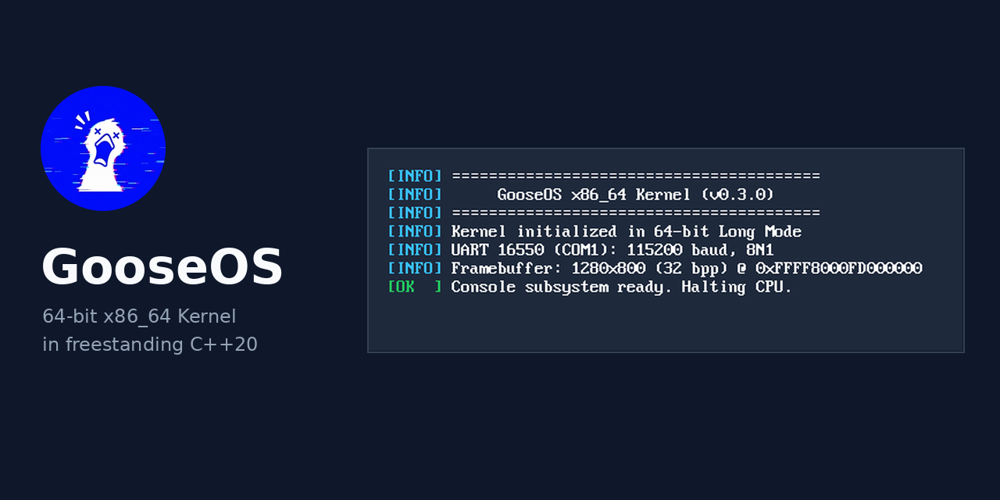

# GooseOS

<a href="https://github.com/UshakovSergeySergey/goose-os/actions/workflows/build.yml?query=branch%3Amain">
  
</a>

*Читать на русском: [README.ru.md](README.ru.md)*



An educational 64-bit `x86_64` operating system kernel written from scratch in freestanding C++20 using the **Limine** boot protocol (`v12.11.1`, base revision `6`).

## Project Structure

* `src/main.cpp` — kernel entry point (`kmain`) and linear framebuffer console initialization.
* `src/arch/x86_64/cpu.hpp` — low-level CPU control primitives (`cli`, `sti`, `hlt`, `pause`).
* `src/arch/x86_64/port.hpp` — type-safe x86 I/O port access (`read<T>`, `write<T>`, `wait`).
* `src/arch/x86_64/linker.ld` — Higher Half Kernel (`0xffffffff80000000`) linker script with 4 KB page alignment.
* `src/drivers/serial.hpp` / `serial.cpp` — UART 16550 (`COM1`) serial port driver for early kernel logging.
* `src/gfx/font8x16.hpp` — 8x16 IBM VGA bitmap font table for framebuffer text rendering.
* `src/gfx/console.hpp` / `console.cpp` — 32-bit XRGB linear framebuffer text console with scrolling and color support.
* `src/lib/text_output.hpp` — CRTP static polymorphism helper for string, decimal, and hexadecimal formatting.
* `src/lib/log.hpp` / `log.cpp` — RAII stream logger (`Log::info()`, `ok()`, `warning()`, `error()`) mirroring output to both Serial and Console.
* `src/lib/traits.hpp` — freestanding C++20 type traits and concepts.
* `assets/bootloader_wallpaper.jpg` — custom mascot wallpaper for the Limine boot menu.
* `limine.conf` — Limine bootloader configuration and theme settings.
* `scripts/setup.sh` — downloads and builds the Limine bootloader SDK into `third-party/limine`.
* `scripts/make-bootable-usb.sh` — flashes the hybrid ISO image onto a USB drive.
* `CMakeLists.txt` — `x86_64-elf` cross-compilation and hybrid ISO packaging setup.

## Prerequisites (Ubuntu / Debian)

Install the required toolchain, ISO builder, and emulator:

```bash
sudo apt update && sudo apt install -y clang lld cmake xorriso qemu-system-x86 curl tar make gcc
```

## Building and Running

1. **Download and build the Limine bootloader SDK** (run once after cloning):
   ```bash
   ./scripts/setup.sh
   ```

2. **Configure the CMake build** (run once or after modifying `CMakeLists.txt`):
   ```bash
   cmake -B build
   ```

3. **Build the ISO image and run in QEMU** (serial logs are routed to `stdio`):
   ```bash
   cmake --build build --target run
   ```

## CMake Targets

| Command | Description |
| :--- | :--- |
| `cmake --build build` | Default target (`all`): compiles the kernel and builds `build/goose-os.iso`. |
| `cmake --build build --target kernel.elf` | Compiles and links only the kernel ELF binary (`build/kernel.elf`). |
| `cmake --build build --target iso` | Builds the hybrid BIOS/UEFI bootable image (`build/goose-os.iso`). |
| `cmake --build build --target run` | Builds the latest ISO image and launches it in QEMU with serial output. |
| `cmake --build build --target clean` | Removes compiled object files and the kernel binary. |

## Flashing to a USB Drive

To create a bootable USB drive (raw `dd` mode supporting both BIOS and UEFI):

1. Identify your USB drive device name (e.g., `/dev/sdb`):
   ```bash
   lsblk -o NAME,SIZE,MODEL,TRAN
   ```

2. Flash the built ISO image using the helper script (**all data on the target drive will be erased**):
   ```bash
   sudo ./scripts/make-bootable-usb.sh build/goose-os.iso /dev/sdX
   ```

> **Note:** To boot on real hardware, disable **Secure Boot** in your UEFI firmware settings.
