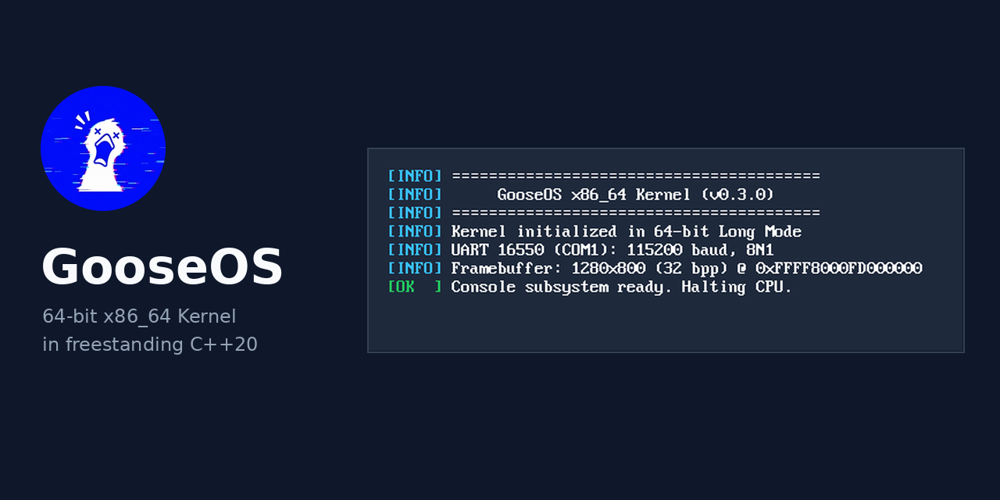

# GooseOS

<a href="https://github.com/UshakovSergeySergey/goose-os/actions/workflows/build.yml?query=branch%3Amain">
  
</a>

*Read in English: [README.md](README.md)*



Учебное 64-битное ядро операционной системы на freestanding C++20 для архитектуры `x86_64`, использующее загрузчик **Limine** (`v12.11.1`, ревизия протокола `6`).

## Структура проекта

* `src/main.cpp` — точка входа в ядро (`kmain`) и инициализация консоли во фреймбуфере (Framebuffer).
* `src/arch/x86_64/cpu.hpp` — низкоуровневое управление ядром процессора (`cli`, `sti`, `hlt`, `pause`).
* `src/arch/x86_64/port.hpp` — типобезопасная работа с портами ввода-вывода x86 (`read<T>`, `write<T>`, `wait`).
* `src/arch/x86_64/linker.ld` — скрипт линковщика (Higher Half Kernel `0xffffffff80000000`, раскладка сегментов по страницам 4 КБ).
* `src/drivers/serial.hpp` / `serial.cpp` — драйвер последовательного порта UART 16550 (`COM1`) для вывода ранних логов ядра.
* `src/gfx/font8x16.hpp` — таблица растрового шрифта IBM VGA 8x16 для отрисовки символов во фреймбуфер.
* `src/gfx/console.hpp` / `console.cpp` — 32-битная текстовая консоль (XRGB) с прокруткой и поддержкой цветов.
* `src/lib/text_output.hpp` — CRTP-база статического полиморфизма для форматирования строк, десятичных и шестнадцатеричных чисел.
* `src/lib/log.hpp` / `log.cpp` — потоковый RAII-логгер (`Log::info()`, `ok()`, `warning()`, `error()`), дублирующий вывод в Serial и Console.
* `src/lib/traits.hpp` — базовые метафункции и концепты C++20 для freestanding-среды.
* `assets/bootloader_wallpaper.jpg` — фоновое изображение с логотипом для меню загрузчика Limine.
* `limine.conf` — конфигурация и цветовая тема загрузчика Limine.
* `scripts/setup.sh` — скрипт загрузки и сборки SDK Limine в `third-party/limine`.
* `scripts/make-bootable-usb.sh` — скрипт побитовой записи образа `.iso` на USB-флешку.
* `CMakeLists.txt` — конфигурация кросс-компиляции (`x86_64-elf`) и упаковки загрузочного `.iso`.

## Зависимости (Ubuntu / Debian)

Для сборки и запуска потребуются:
* `clang`, `lld`, `cmake`
* `xorriso` (для создания гибридного ISO-образа)
* `qemu-system-x86` (для запуска в виртуальной машине)
* `curl`, `tar`, `make`, `gcc` (для первичной настройки Limine)

```bash
sudo apt update && sudo apt install -y clang lld cmake xorriso qemu-system-x86 curl tar make gcc
```

## Первичная настройка и сборка

1. **Скачать и подготовить загрузчик Limine** (выполняется один раз после клонирования):
   ```bash
   ./scripts/setup.sh
   ```

2. **Сконфигурировать сборку CMake** (выполняется один раз или после изменения `CMakeLists.txt`):
   ```bash
   cmake -B build
   ```

3. **Собрать образ и запустить в QEMU** (вывод Serial-порта перенаправлен в `stdio`):
   ```bash
   cmake --build build --target run
   ```

## Цели сборки (CMake Targets)

| Команда | Описание |
| :--- | :--- |
| `cmake --build build` | Цель по умолчанию (`all`): компилирует ядро и собирает `build/goose-os.iso`. |
| `cmake --build build --target kernel.elf` | Компилирует и линкует только исполняемый бинарник ядра `build/kernel.elf`. |
| `cmake --build build --target iso` | Собирает гибридный загрузочный образ `build/goose-os.iso` (BIOS + UEFI). |
| `cmake --build build --target run` | Собирает актуальный `.iso` и запускает его в эмуляторе QEMU. |
| `cmake --build build --target clean` | Очищает скомпилированные объектные файлы и бинарник ядра. |

## Запись на USB-флешку

Для создания загрузочной флешки (режим побитовой записи `dd` для BIOS и UEFI):

1. Определите имя устройства вашей флешки (например, `/dev/sdb`):
   ```bash
   lsblk -o NAME,SIZE,MODEL,TRAN
   ```

2. Запишите собранный образ с помощью скрипта (все данные на флешке будут удалены):
   ```bash
   sudo ./scripts/make-bootable-usb.sh build/goose-os.iso /dev/sdX
   ```

> **Примечание:** для запуска на реальном ПК в настройках UEFI необходимо отключить **Secure Boot**.
